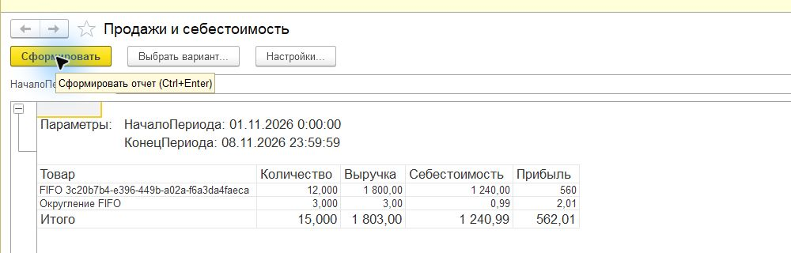
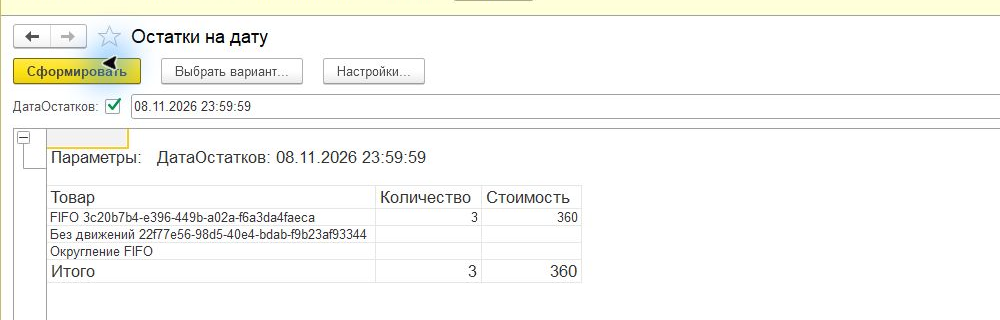
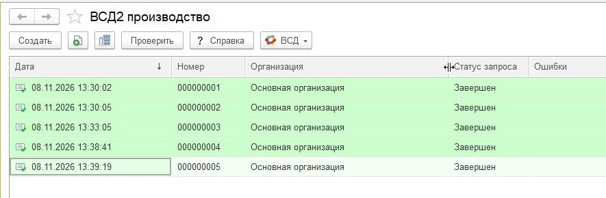

# Отчёт по лабораторной работе

**ФИО:** Мельников Руслан Дмитриевич

**Неделя / Лаба:** неделя 3 — запросы, многорегистровое проведение, FIFO и производство в Меркурии.

**Дата:** 8 ноября 2026 года.

**Цель работы:** реализовать партийный учёт и себестоимость FIFO, освоить запросы виртуальных таблиц и выполнить производственный обмен с тестовым Меркурием.

**Среда:** Windows, учебная 1С 8.5.1.1150, файловые базы.

Выполнены проведение по трём регистрам, расчёт FIFO и отчёты СКД. В отдельной демобазе кб99 настроен тестовый Ветис.API и выпущены пять партий продукции с подтверждёнными заявками, записями складского журнала и ВСД.

## Шаги воспроизведения

1. Создать проект третьей недели на основе XML-выгрузки второй недели. Добавить регистр остатков ПартииТоваров с измерениями Товар и Партия и ресурсами Количество и Стоимость. Партия определяется документом поступления.
2. Дополнить Продажи ресурсом Себестоимость. Поступление формирует приход количества и стоимости партии. Реализация сворачивает повторные строки товара, получает остатки на момент документа и последовательно списывает ранние партии.
3. Установить управляемые блокировки по товарам, проверять заполнение документов и доступность остатка. При дефиците откатывать всю транзакцию. Запретить изменения прошлого при наличии последующих движений.
4. Создать СКД-отчёты ОстаткиНаДату и ПродажиИСебестоимость. В первом использовать левое соединение справочника товаров с виртуальной таблицей остатков; параметры передавать в виртуальные таблицы.
5. Загрузить выгрузку в пустую базу, обновить структуру, проверить сервер и тонкий клиент. Выполнить scripts/Test-Week3.ps1, затем сформировать отчёты в приложении.

## Что должно получиться

| Проверка | Ожидаемый результат | Получено |
| --- | --- | --- |
| FIFO двух партий | 10 × 100 + 2 × 120 | Себестоимость 1 240 |
| Продажи 12 по 150 | Выручка 1 800 | Прибыль 560 |
| Остаток после продажи | 3 единицы второй партии | Стоимость 360 |
| Остаток на 1 ноября | Без будущих документов | 10 единиц на 1 000 |
| Повторное проведение | Без дублирования | Подтверждено |
| Дефицит | Сохранить прежние движения | Подтверждено |
| Отмена проведения | 15 единиц на 1 600 | Подтверждено |
| Товар без движений | Сохранить в левом соединении | Подтверждено |
| Формирование СКД | Три отчёта без ошибок | Подтверждено |

[Полный протокол проверок 1С](Проверка_1С.txt). [Синтаксическая проверка](Синтаксическая_проверка.txt).

## Настройка и разбор Меркурия

1. Предоставленный Ветис.cf развёрнут в отдельной файловой базе mercury-week3-production. Дистрибутив кб99 сохранён отдельно от складской конфигурации.
2. Для основной организации сохранены параметры API: param_username, param_password, param_api_key, param_issuer_id и param_intiator_login. Последний соответствует учётной записи Ветис Паспорта. Значения паролей и ключа в отчёт не включены.
3. Проверен тестовый адрес api2.vetrf.ru, порт 8002. В запросе модуль использует версию сервиса mercury-g2b.service:2.1. Продукция и её владелец получены из тестового API.
4. Выбрана Площадка_1 Самара с GUID aec24873-ab51-4c3f-870f-01371347258a. Продукция Яйцо куриное свежее зарегистрирована именно на этой площадке: GUID fc8dd0c8-e89b-46fa-af09-3055a68d3fed, UUID 3535c5da-1cc8-4fa0-84be-3f28d410b1f3. Единица измерения — шт.
5. Созданы пять документов ВСД2_Производство с отдельными номерами партий W3-20261108-01–05, объёмами 10, 20, 30, 40 и 50 шт. Дата изготовления 08.11.2026, срок годности до 03.12.2026. Использован сценарий первичного производства без исходного сырья.
6. Для каждого документа отправлена заявка registerProductionOperationRequest. После получения COMPLETED проверены проведение документа, GUID и UUID складской партии, UUID производственного ВСД и точный объём. Общий выпуск — 150 шт.

В документе ВСД2_Производство шапка задаёт организацию, производителя и площадку. Табличная часть Продукция содержит выпускаемые партии, количество, единицу, даты и номер партии; ПартииСписания задаёт используемое сырьё. Для незавершённой операции применяется operationId, а ЗавершитьОперацию определяет закрытие транзакции. В этой практике оформлены отдельные завершённые производственные операции.

## Выпущенные партии

| Документ | Количество шт | ApplicationID | Статус |
| --- | ---: | --- | --- |
| 000000001 | 10 | b4f0bd81-fcdc-4168-a866-48775a59cf09 | COMPLETED |
| 000000002 | 20 | 0c8a6e02-a475-439f-9813-9f395736125d | COMPLETED |
| 000000003 | 30 | 15861367-f72f-4517-b208-473ee2bb03a4 | COMPLETED |
| 000000004 | 40 | 173935e9-ebf9-4fe1-a573-f04dea6e8674 | COMPLETED |
| 000000005 | 50 | 88ec1f29-8052-4800-9357-72ae00c12b13 | COMPLETED |

[Независимая проверка партий и ВСД](Меркурий_проверка.txt). [Полные идентификаторы JSON](Партии.json).

### Партия 1 W3 20261108 01

- Дата документа: 08.11.2026 13:30:02.
- GUID записи журнала: `83db6013-4517-4c0f-8ac2-a73418e71b2e`.
- UUID записи журнала: `6d08ace4-7d06-4fd4-aa5d-4060dd6bea82`.
- UUID ВСД: `3fbf4a2f-9e5b-4b67-92cb-915f8e835f7d`.

### Партия 2 W3 20261108 02

- Дата документа: 08.11.2026 13:30:05.
- GUID записи журнала: `cf38307f-e193-441f-8c3d-3f545dc2e4de`.
- UUID записи журнала: `6495cd70-ecce-4340-b7fc-2ef146c9ae33`.
- UUID ВСД: `84fbdd8e-1881-43fa-beec-1fe5e066a0da`.

### Партия 3 W3 20261108 03

- Дата документа: 08.11.2026 13:33:05.
- GUID записи журнала: `d617c380-6988-4444-9b1b-fa6d1fc8f66e`.
- UUID записи журнала: `5925c1e6-2e5d-49f0-ab40-769200ba025d`.
- UUID ВСД: `d04910f6-6e8b-4d2c-8799-66c5a22783ef`.

### Партия 4 W3 20261108 04

- Дата документа: 08.11.2026 13:38:41.
- GUID записи журнала: `ccdd0667-f6c3-4843-a858-d9923fa4c15b`.
- UUID записи журнала: `d6a36fcc-359f-4487-9768-befdb43ae987`.
- UUID ВСД: `7c9f4064-f569-4b22-a31c-fd358a51a1ad`.

### Партия 5 W3 20261108 05

- Дата документа: 08.11.2026 13:39:19.
- GUID записи журнала: `c74d9653-3c66-4b67-b7e4-3c4122ffde43`.
- UUID записи журнала: `e09523b8-1ce4-4106-a7e2-62ecc50fc59e`.
- UUID ВСД: `2b33fe19-7c40-458a-949d-07cf19b9259c`.

## Снимки результата

На снимках складских отчётов отдельно виден дополнительный товар для проверки округления. Его продажи 3 / 3,00 и себестоимость 0,99 входят в общий итог, но не в основной сценарий 12 / 1 800 / 1 240. Пустые числовые ячейки отчёта остатков отображают нули.

## Замеченные ошибки и ограничения

- Учебная платформа ограничивает размер справочников и число подключений к одной базе. Полная инициализация видов продукции достигла лимита, поэтому для выпуска создана чистая база и загружены только нужные записи. Ограничения платформы не изменялись.
- В исходной демоконфигурации параметр сеанса ТекущийПользователь не инициализировался при отсутствии пользователей информационной базы. Для демонстрационного запуска установлена ссылка на элемент справочника пользователей. Учётные записи и права доступа не изменялись.
- Тестовый API иногда отвечал с задержкой. При повторном запуске существующие COMPLETED-заявки не отправлялись повторно. При ACCEPTED или IN_PROCESS запрашивался результат имеющегося ApplicationID. Если ответ submit был потерян, повторялся неизменённый запрос с прежним localTransactionId, исключающим повторную обработку на стороне сервера.
- Складской FIFO требует последовательного проведения: автоматический перерасчёт последующих документов не реализован. Проверки конкурентных сеансов ограничены учебной платформой; управляемые блокировки предусмотрены кодом.
- Исходники и отчёт подготовлены локально. Публикация на GitHub, отправка работы в учебный кабинет и теоретический тест не выполнялись.

## Вывод

FIFO, отчёты и контроль проведения проверены на платформе и после восстановления в пустую базу. Из 1С выпущены пять партий общим объёмом 150 шт.; для каждой проверены COMPLETED, складская партия и производственный ВСД.

## Источники

- [Практика недели 3](https://github.com/phsin/kb99-1c-start/blob/main/week3.md).
- [Шаблон отчёта](https://github.com/phsin/kb99-1c-start/blob/main/Отчет_шаблон.md).
- [Документация кб99 по производству](https://docs.kb99.pro/s/vetis-for-1cv8/doc/proizvodstvo-produkcii-HQX8LZMQJ6).
- Исходники предоставленного Ветис.cf и фактические ответы тестового API.
